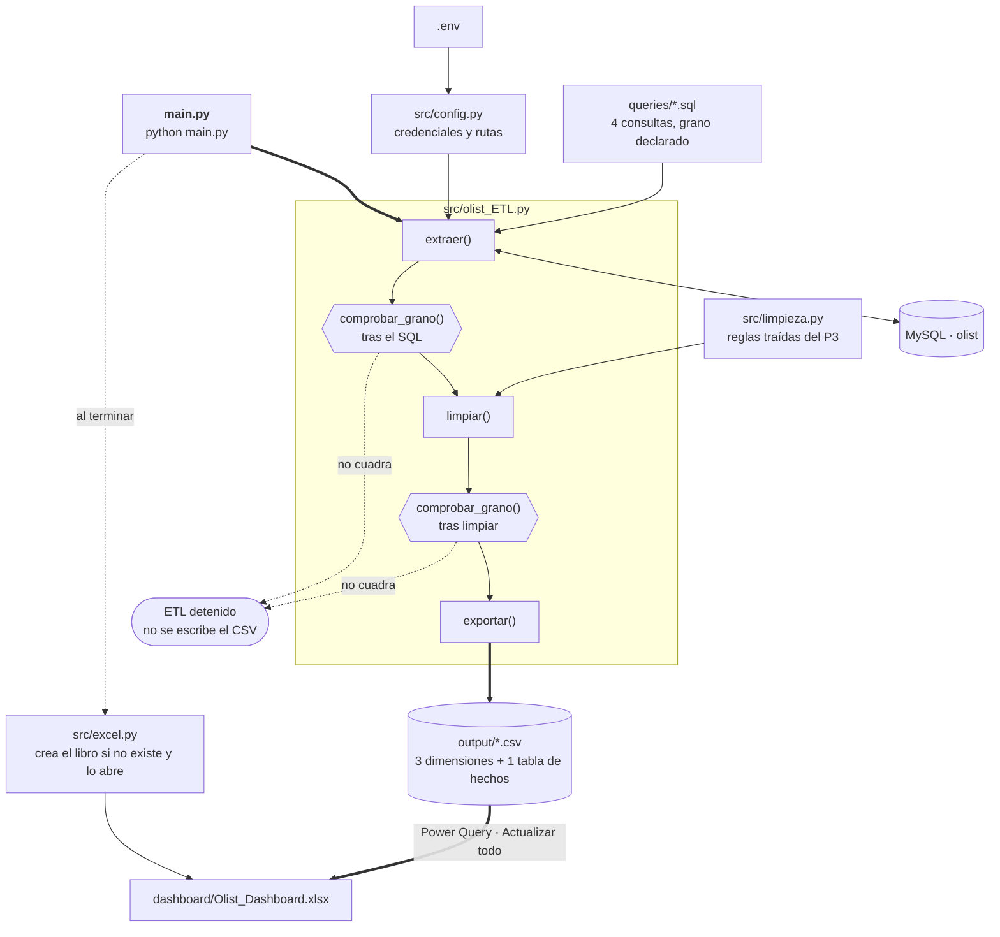
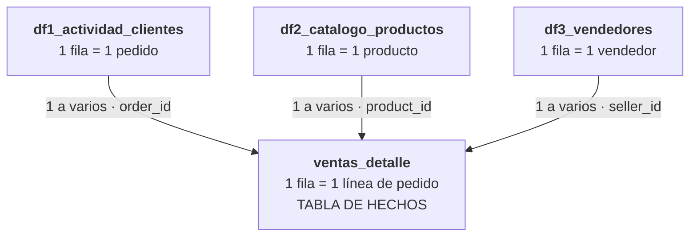
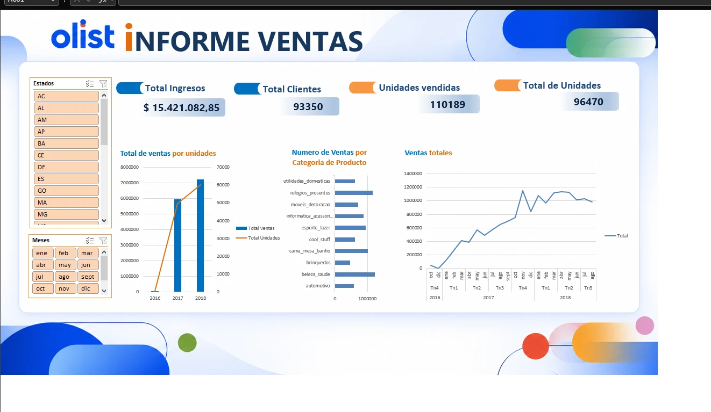

# Flujo de Datos de SQL a Python: automatización MySQL a Excel con Olist


**Proyecto IV** del Bootcamp de Data Analyst. Continuación del Proyecto III: allí sacamos un dataset a mano (una consulta, una ejecución, un CSV). Aquí lo convertimos en un proceso que se ejecuta solo:

1. Python lanza las consultas de `queries/` contra la base Olist en MySQL.
2. Comprueba que cada resultado respeta el grano declarado.
3. Aplica las reglas de limpieza del Proyecto III.
4. Deja un CSV por consulta en `output/`.
5. Excel lee esos CSV con Power Query, los relaciona en un modelo de datos y alimenta el dashboard.

## Integrantes
- Tania
- Lena
- Eddy
- Franco

## Tecnologías utilizadas
- **MySQL**: base de datos Olist y consultas de extracción
- **Python**: Pandas, SQLAlchemy, mysql-connector-python, python-dotenv, openpyxl
- **Excel**: Power Query, modelo de datos, tablas dinámicas y dashboard
- **Power BI**: dashboard interactivo sobre el mismo modelo en estrella
- **Jupyter / Google Colab**: exploración y pruebas de limpieza
- **Git y GitHub**: control de versiones

---

## Acceso al dashboard y a los datos

Todos los entregables están en la carpeta [`dashboard/`](dashboard/) de este repositorio:

| Entregable | Fichero | Cómo abrirlo |
| :--- | :--- | :--- |
| **Dashboard Excel** | [`dashboard/Olist_Dashboard.xlsx`](dashboard/Olist_Dashboard.xlsx) | Excel de escritorio |
| **Dashboard Power BI** | [`dashboard/Olist_Dashboard.pbix`](dashboard/Olist_Dashboard.pbix) | Power BI Desktop |
| **Informe ejecutivo** | [`dashboard/Informe Ejecutivo Olist.pdf`](dashboard/Informe%20Ejecutivo%20Olist.pdf) | Cualquier lector de PDF o la vista previa de GitHub |

> [!TIP]
> GitHub no previsualiza `.xlsx` ni `.pbix`: abrid el fichero y pulsad **Download raw file** para verlo en local. El Excel pesa cerca de 100 MB porque lleva el modelo de datos cargado; para usar segmentaciones, tablas dinámicas y modelo, abridlo con **Excel de escritorio**.

---

## Arquitectura



- **`main.py`** llama a `ejecutar_etl()` y, al terminar, a `src/excel.py`.
- **`src/olist_ETL.py`** recorre las consultas siempre en el mismo orden: extraer, comprobar grano, limpiar, comprobar grano, exportar.
- **Los dos controles de grano** detienen el proceso si una consulta devuelve más filas que valores distintos en su clave: un JOIN que multiplica filas no llega nunca al dashboard.
- **`src/excel.py`** no diseña nada: crea el libro con una hoja *Fuentes* solo si no existe y lo abre. Nunca pisa el dashboard.

---

## Estructura

```
.
├── main.py                          <- se ejecuta esto
├── src/
│   ├── config.py                       lee las credenciales y rutas del .env
│   ├── olist_ETL.py                    extraer, comprobar grano, limpiar, exportar
│   ├── limpieza.py                     reglas de limpieza, una por función
│   └── excel.py                        crea y abre el libro de Excel
├── queries/
│   ├── ventas_detalle.sql              tabla de hechos
│   ├── df1_actividad_clientes.sql      dimensión pedidos / clientes
│   ├── df2_catalogo_productos.sql      dimensión productos
│   └── df3_vendedores.sql              dimensión vendedores
├── notebooks/
│   └── exploracion.ipynb               exploración y pruebas (fuera del proceso automático)
├── dashboard/
│   ├── README.md                       cómo conectar Excel a los CSV y montar el modelo
│   ├── Olist_Dashboard.xlsx            dashboard final en Excel
│   ├── Olist_Dashboard.pbix            dashboard en Power BI
│   └── Informe Ejecutivo Olist.pdf     informe ejecutivo con hallazgos y conclusiones
├── output/                          <- CSV generados. NO se suben
├── img/                                imágenes del README
├── .env                             <- credenciales. NO se sube
├── .env_example                        plantilla del .env
├── requirements.txt
└── README.md
```

---

## Los cuatro DataFrames

En el Proyecto III cada integrante construyó un dataset resumido (DF1, DF2, DF3). Esos tres no comparten ninguna clave entre sí, así que por sí solos no permiten un dashboard cruzado. Por eso se añade una cuarta consulta, **`ventas_detalle`**, al grano de línea de pedido: es el único nivel donde coinciden pedido, producto y vendedor, y actúa como **tabla de hechos** de un esquema en estrella.

| Consulta | Papel | Grano (una fila es) | Clave de grano | Filas |
| :--- | :--- | :--- | :--- | ---: |
| `ventas_detalle` | **tabla de hechos** | una línea de pedido entregado | `linea_id` | 110.189 |
| `df1_actividad_clientes` | dimensión | un pedido entregado con su cliente | `order_id` | 96.470 |
| `df2_catalogo_productos` | dimensión | un producto con dimensiones válidas | `product_id` | 32.945 |
| `df3_vendedores` | dimensión | un vendedor | `seller_id` | 3.095 |

### `ventas_detalle`: tabla de hechos
Une `order_items`, `orders` y `customers`. Solo pedidos con estado `delivered` y fecha de entrega.
- `linea_id`: clave construida como `order_id-order_item_id`.
- Claves hacia las dimensiones: `order_id`, `customer_unique_id`, `product_id`, `seller_id`.
- Medidas: `precio`, `flete`, `importe_linea` (precio + flete) y `fecha_compra`.
- Limpieza en Python (`tipar_hechos_ventas`): fecha a datetime e importes a numérico.

### DF1: `df1_actividad_clientes`
Pedido entregado con su cliente, localización, pagos y satisfacción.
- Evita la trampa de `geolocation` agregando lat/lng por código postal antes del JOIN.
- Pagos agregados por pedido (`total_payment_value`, `payment_installments_count`, `payment_types_used`), excluyendo importes 0 y tipo `not_defined`.
- Reseñas agregadas por pedido (`avg_review_score`).
- Derivadas: `delivery_days` (días entre compra y entrega) e `is_late` (1 si se entregó después de la fecha estimada).
- Limpieza en Python (`tipar_fechas`): columnas `_date`, `_timestamp` y `_at` a datetime.

### DF2: `df2_catalogo_productos`
Catálogo de productos con métricas comerciales.
- Descarta productos sin peso o dimensiones válidas.
- Categoría normalizada (`categoria_pt`), los 610 nulos pasan a `unknown`.
- Categoría traducida al inglés (`categoria_en`), resolviendo las 2 categorías sin traducción.
- Métricas agregadas desde `order_items`: unidades vendidas, vendedores distintos, precio medio/mín/máx, coste de envío medio.
- Derivadas: `is_heavy` (>= 5 kg) y `freight_ratio` (envío / precio).

### DF3: `df3_vendedores`
Vendedor con su volumen y amplitud de catálogo. Se agrega `order_items` por vendedor **antes** de unir con `sellers` para no multiplicar filas.
- Ciudad y estado normalizados.
- Métricas: `unidades_vendidas`, `catalogo_productos`, `categorias`, `pedidos`, `ingresos`, `flete`.
- Limpieza en Python:
  - `marcar_vendedores_atipicos`: marca (no borra) los vendedores fuera del rango IQR. En el Proyecto III se decidió no suprimirlos porque son los *best-sellers*.
  - `cuota_de_mercado`: `pct_unidades_total`, porcentaje de unidades del marketplace de cada vendedor.

---

## Modelo de datos en Excel



| Tabla (lado varios) | Columna | Tabla relacionada (lado uno) | Columna |
| :--- | :--- | :--- | :--- |
| `ventas_detalle` | `order_id` | `df1_actividad_clientes` | `order_id` |
| `ventas_detalle` | `product_id` | `df2_catalogo_productos` | `product_id` |
| `ventas_detalle` | `seller_id` | `df3_vendedores` | `seller_id` |

**Regla de oro:** las medidas (dinero, unidades, líneas) se suman siempre desde `ventas_detalle`. Las columnas numéricas de las dimensiones están calculadas a su propio grano y sirven para ordenar y filtrar, no para sumar en dinámicas cruzadas.

El paso a paso de Power Query y las relaciones está en [`dashboard/README.md`](dashboard/README.md).

---

## Puesta en marcha

### 1. Base de datos
Olist cargada en MySQL (la misma del Proyecto III):

```sql
USE olist;
SELECT COUNT(*) FROM orders;   -- 99441
```

### 2. Entorno

```bash
python -m venv .venv
.venv\Scripts\activate        # Windows
source .venv/bin/activate     # macOS y Linux
pip install -r requirements.txt
```

### 3. Credenciales
Copiad `.env_example` como `.env` y rellenadlo:

```
DB_USER=root
DB_PASSWORD=vuestra_contraseña
DB_HOST=localhost
DB_PORT=3306
DB_NAME=olist
```

Opcionales: `OUTPUT_FOLDER` (por defecto `output`), `EXCEL_FILE` (por defecto `dashboard/Olist_Dashboard.xlsx`) y `AUTO_OPEN_EXCEL` (por defecto `true`). El `.env` está en `.gitignore` y no se sube nunca.

### 4. Ejecutar
Desde la raíz del proyecto:

```bash
python main.py
```

Salida esperada (los números dependen de la carga de la base):

```
CSV generados en output/:
  ventas_detalle          110189 filas   ventas_detalle.csv
  df1_actividad_clientes   96470 filas   df1_actividad_clientes.csv
  df2_catalogo_productos   32945 filas   df2_catalogo_productos.csv
  df3_vendedores            3095 filas   df3_vendedores.csv
```

### 5. Actualizar el dashboard
Abrid el Excel y pulsad `Datos` > `Actualizar todo`. El orden importa: primero el script regenera los CSV, luego Excel los relee.

---

## Limpieza: qué va en SQL y qué en Python

| Tipo de regla | Dónde |
| :--- | :--- |
| Filtros, valores por defecto, agregaciones | **SQL**: corre en el servidor y reduce lo que viaja |
| Necesita el conjunto entero (atípicos, percentiles, cuotas) | **`src/limpieza.py`** |
| Tipado de fechas e importes | **`src/limpieza.py`** |
| Cualquier cosa | **nunca en Excel**: no se versiona ni se repite |

Para añadir una consulta nueva: guardar el `.sql` en `queries/` y añadir una línea al diccionario `CONSULTAS` de `src/olist_ETL.py` con su clave de grano. El resto del ETL no se toca.

---

## Dashboard

### Excel



| Bloque | Qué muestra | Origen |
| :--- | :--- | :--- |
| **Total Ingresos** | Suma de `importe_linea` (precio + flete) | `ventas_detalle` |
| **Total Clientes** | Clientes únicos (`customer_unique_id`) | `ventas_detalle` |
| **Unidades vendidas** | Líneas de pedido (en Olist cada línea es una unidad) | `ventas_detalle` |
| **Total pedidos** | Pedidos entregados | `df1_actividad_clientes` |
| **Total de ventas por unidades** | Ingresos (barras) y unidades (línea) por año | `ventas_detalle` |
| **Ventas por categoría** | Ingresos de las 10 categorías principales | `ventas_detalle` + `df2_catalogo_productos` |
| **Ventas totales** | Evolución mensual de los ingresos, oct 2016 a ago 2018 | `ventas_detalle` |
| **Segmentaciones** | Estado del cliente y mes de compra. Filtran todas las dinámicas a la vez gracias al modelo | `df1_actividad_clientes` y `ventas_detalle` |

### Power BI

[`dashboard/Olist_Dashboard.pbix`](dashboard/Olist_Dashboard.pbix) monta el mismo modelo en estrella (`ventas_detalle` como tabla de hechos y las tres dimensiones) en Power BI. Abridlo con **Power BI Desktop** y pulsad `Actualizar` después de ejecutar `python main.py` para que relea los CSV de `output/`.

---

## Informe ejecutivo

**[`dashboard/Informe Ejecutivo Olist.pdf`](dashboard/Informe%20Ejecutivo%20Olist.pdf)** resume en tres páginas los resultados del análisis para un público de negocio:

1. **Volumen de negocio y crecimiento:** 15,42 M de ingresos, 96.470 pedidos, ticket medio de 159,83 y una tasa de repetición del 3 %.
2. **Comportamiento de compra:** las cinco categorías principales concentran el 39,3 % de los ingresos.
3. **Distribución geográfica:** SP, RJ y MG suman el 62,5 % de los ingresos; SP despacha el 64,6 % de lo vendido.
4. **Logística y satisfacción:** el 8,1 % de los pedidos llega tarde y la nota cae de 4,29 a 2,57 con retraso. Cierra con una conclusión estratégica.

Los hallazgos de la siguiente sección son la versión resumida de este informe.

---

## Hallazgos principales

Cifras calculadas sobre los CSV de `output/` (pedidos entregados).

- **Volumen:** 15,4 M de ingresos en 96.470 pedidos y 110.189 unidades, de 93.350 clientes. Ticket medio de **159,83 por pedido**.
- **Crecimiento:** de 6,9 M en 2017 a 8,5 M en 2018 con solo ocho meses de datos. El pico mensual es **noviembre de 2017 (1,15 M, Black Friday)**; desde entonces la facturación se estabiliza entre 1,0 y 1,1 M al mes.
- **Categorías:** de 74, las cinco primeras (`beleza_saude`, `relogios_presentes`, `cama_mesa_banho`, `esporte_lazer`, `informatica_acessorios`) suman el **39,3 %** de los ingresos.
- **Geografía:** SP, RJ y MG concentran el **62,5 %** de los ingresos por estado del cliente, y el **64,6 %** de lo vendido sale de vendedores de SP.
- **Logística y satisfacción:** el **8,1 %** de los pedidos llega tarde. La nota media cae de **4,29 a 2,57** cuando hay retraso; en estados del norte y nordeste como AL o MA el retraso supera el 19 %.
- **Fidelización:** solo el **3 %** de los clientes repite compra.
- **Flete:** supone el **14,3 %** de lo que paga el cliente.

### Recomendaciones

1. **Priorizar la logística fuera del eje SP-RJ-MG.** El retraso es el factor que más hunde la nota, y se concentra en los estados lejanos de los vendedores. Revisar transportistas y fechas estimadas en el norte y nordeste.
2. **Activar la recompra.** Con un 3 % de clientes recurrentes, una campaña posventa sobre las categorías líderes (salud y belleza, hogar, deporte) tiene mucho margen.
3. **Preparar picos estacionales.** Noviembre multiplica la demanda: planificar stock y capacidad de envío de las categorías top antes del Black Friday.
4. **Captar vendedores fuera de SP.** Dos de cada tres reales salen de vendedores paulistas; vendedores locales en otros estados acortarían envíos y bajarían flete y retrasos.

---

## Limitaciones y siguientes pasos

- **Mapa de puntos de compra y venta.** Queríamos situar en un mapa a clientes y vendedores para ver de dónde sale y a dónde llega cada envío. DF1 ya trae `customer_lat` y `customer_lng`, pero DF3 no tiene coordenadas del vendedor, y los gráficos de mapa de Excel solo pintan por región, no por puntos sobre el modelo de datos. Para hacerlo habría que añadir a `df3_vendedores.sql` las coordenadas desde `geolocation` (agregando por código postal antes del JOIN, como en DF1) y montar el mapa en Power BI.
- **Medidas calculadas.** Ratios como ticket medio, % de retraso o flete sobre factura no se pueden definir una vez y reutilizar en todas las dinámicas; en Power BI serán medidas DAX.
- **Tabla calendario.** Las fechas se agrupan con la jerarquía automática de Excel. Una tabla calendario propia permitiría comparar periodos (mes contra mes del año anterior).

Estas limitaciones son el guion del **Proyecto V**, donde el mismo modelo se rehace en Power BI. El primer paso de ese trabajo ya está en [`dashboard/Olist_Dashboard.pbix`](dashboard/Olist_Dashboard.pbix).
